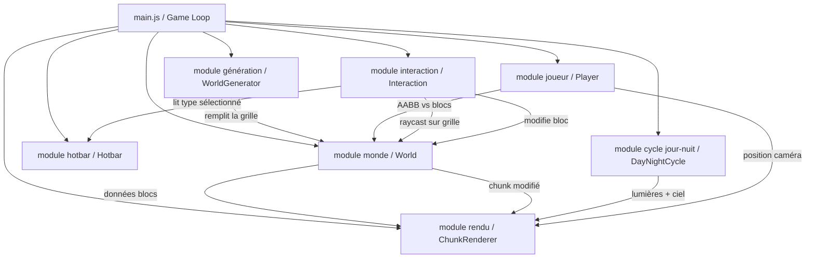
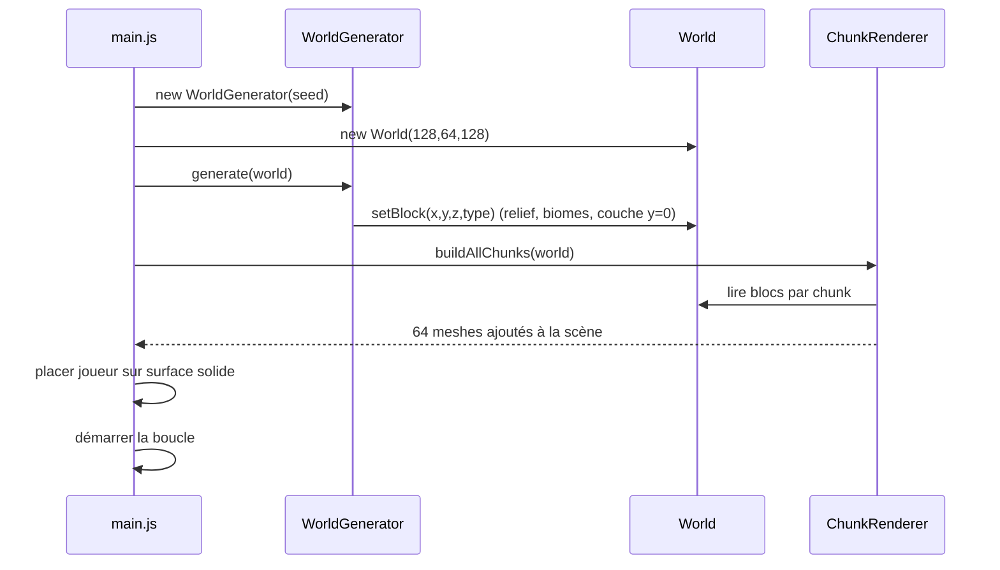

# Document de conception — AfroCraft (MVP)

## Overview

AfroCraft est un jeu voxel 3D en vue première personne qui s'exécute entièrement dans le navigateur, sans serveur. Le rendu 3D repose sur **Three.js**, et l'outillage de développement/build sur **Vite** (modules ES natifs en dev, bundling optimisé en production). Toute la logique — génération procédurale, physique, interaction, rendu — tourne côté client dans la boucle d'animation du navigateur.

Le monde fait 128×128 blocs à l'horizontale et 64 blocs de hauteur (Exigence 1.2, 13.5). Il est découpé en **chunks de 16×16×64 blocs**, ce qui donne une grille de **8×8 = 64 chunks** couvrant tout le monde. Chaque chunk est rendu par un **unique mesh** sur lequel seules les faces visibles sont dessinées (aucune face entre deux blocs pleins) : c'est le cœur de la stratégie de performance pour tenir les cibles 60/30 ips (Exigence 13.2, 13.3). Quand un bloc est cassé ou posé, **seul le chunk concerné est reconstruit** (plus ses voisins immédiats si le bloc touche une frontière), garantissant une mise à jour sous 100 ms (Exigence 6.4, 7.6, 13.4).

L'architecture est volontairement modulaire et découplée : la donnée (grille de blocs) est séparée du rendu (meshing), de la génération (bruit + seed), de la physique du joueur (collisions AABB), de l'interaction (raycasting sur grille), de l'interface (hotbar) et de l'ambiance (cycle jour/nuit). Chaque module expose une API publique claire, ce qui facilite les tests et l'évolution.

## Architecture

### Vue d'ensemble des modules



### Flux de la boucle de jeu (frame)

```mermaid
sequenceDiagram
    participant Loop as Boucle (requestAnimationFrame)
    participant Input as Entrées
    participant Player as Joueur
    participant World as Monde
    participant Inter as Interaction
    participant Day as CycleJourNuit
    participant Rend as Rendu (Three.js)

    Loop->>Input: lire clavier/souris
    Loop->>Player: update(dt, input, world)
    Player->>World: tester collisions AABB
    World-->>Player: position corrigée
    Loop->>Inter: update() raycast sur grille
    Inter->>World: lire blocs le long du rayon
    World-->>Inter: bloc visé + face
    Inter->>Rend: déplacer surbrillance
    Loop->>Day: update(dt)
    Day->>Rend: ajuster lumière + couleur ciel
    Loop->>Rend: render(scene, camera)
```

### Initialisation (démarrage de partie)



### Structure de fichiers (modules ES)

```
index.html
vite.config.js
src/
  main.js                 // point d'entrée, boucle de jeu, câblage des modules
  world/
    World.js              // grille de blocs, chunks, getBlock/setBlock
    Chunk.js              // conteneur de données d'un chunk + état "dirty"
    blocks.js             // définitions des 9 types + bedrock (couleurs, solidité)
  generation/
    WorldGenerator.js     // bruit + seed, relief, biomes, bedrock
    noise.js              // bruit de valeur/Perlin seedé
    biomes.js             // carte des biomes et peuplement de surface
  rendering/
    ChunkRenderer.js      // meshing face-culling, un mesh par chunk
    materials.js          // matériaux Three.js par type de bloc
    highlight.js          // wireframe de surbrillance du bloc visé
  player/
    Player.js             // caméra FPS, gravité, saut, intégration mouvement
    Physics.js            // résolution de collision AABB vs grille
  interaction/
    Interaction.js        // raycast sur grille, casser/poser, portée 5 blocs
    PointerLock.js        // capture de la souris (pointer lock)
  ui/
    Hotbar.js             // 9 cases, sélection, molette, touches 1-9
  environment/
    DayNightCycle.js      // cycle 10 min, lumière ambiante + couleur ciel
```

---

## Data Models

### Types de blocs (module `world/blocks.js`) — Exigence 5

Chaque type de bloc est identifié par un entier (stocké dans la grille) et décrit par une table de métadonnées. L'eau est non solide ; la bedrock est incassable et distincte visuellement.

```javascript
// Identifiants numériques stockés dans la grille (Uint8)
export const BLOCK = Object.freeze({
  AIR:            0,  // vide, non rendu
  TERRE_ROUGE:    1,  // Exigence 5.1
  HERBE_SAVANE:   2,
  HERBE_FORET:    3,  // vert plus foncé que savane (5.3)
  SABLE:          4,
  PIERRE:         5,
  BOIS_BAOBAB:    6,
  FEUILLES:       7,
  EAU:            8,  // non solide, immobile (5.4)
  ARGILE:         9,
  BEDROCK:        10, // couche incassable y=0, visuellement distincte (1.6, 5.6)
});

// Métadonnées par type — Exigence 5.1, 5.2, 5.4, 5.5, 5.6
export const BLOCK_DATA = {
  [BLOCK.TERRE_ROUGE]:  { nom: 'Terre rouge',     solide: true,  opaque: true,  couleur: 0x9c3b1b, placable: true },
  [BLOCK.HERBE_SAVANE]: { nom: 'Herbe de savane', solide: true,  opaque: true,  couleur: 0x9bbd4e, placable: true },
  [BLOCK.HERBE_FORET]:  { nom: 'Herbe de forêt',  solide: true,  opaque: true,  couleur: 0x2f7d32, placable: true }, // 5.3 plus foncé
  [BLOCK.SABLE]:        { nom: 'Sable',           solide: true,  opaque: true,  couleur: 0xe4d6a7, placable: true },
  [BLOCK.PIERRE]:       { nom: 'Pierre',          solide: true,  opaque: true,  couleur: 0x7d7d7d, placable: true },
  [BLOCK.BOIS_BAOBAB]:  { nom: 'Bois de baobab',  solide: true,  opaque: true,  couleur: 0x6b4a2b, placable: true },
  [BLOCK.FEUILLES]:     { nom: 'Feuilles',        solide: true,  opaque: true,  couleur: 0x4e8a3a, placable: true },
  [BLOCK.EAU]:          { nom: 'Eau',             solide: false, opaque: false, couleur: 0x2a6fdb, placable: true, transparence: 0.6 }, // 5.4
  [BLOCK.ARGILE]:       { nom: 'Argile',          solide: true,  opaque: true,  couleur: 0xb08968, placable: true },
  [BLOCK.BEDROCK]:      { nom: 'Socle incassable', solide: true, opaque: true,  couleur: 0x1e1e24, placable: false, cassable: false }, // 1.6, 5.6
};

export const isSolide  = (t) => BLOCK_DATA[t]?.solide === true;        // 5.4, 5.5
export const isOpaque  = (t) => BLOCK_DATA[t]?.opaque === true;        // meshing
export const isCassable = (t) => t !== BLOCK.AIR && t !== BLOCK.EAU && t !== BLOCK.BEDROCK; // 6.6, 6.7
```

**Règles de validation / invariants :**
- La grille ne contient que des valeurs présentes dans `BLOCK`.
- `EAU` est le seul bloc `placable: true` mais `solide: false` (Exigence 5.4).
- `BEDROCK` n'apparaît jamais dans la hotbar (`placable: false`) et n'est jamais cassable (Exigence 6.7).
- Les 9 types placables correspondent exactement aux 9 cases de la hotbar (Exigence 8.2).

### Modèle de données de la grille de blocs — Exigence 1

La grille complète du monde est stockée dans des tableaux typés par chunk pour la compacité mémoire (1 octet par bloc). Un chunk fait 16×16×64 = 16 384 blocs → 64 chunks × 16 Ko = 1 Mo pour tout le monde.

```javascript
// world/Chunk.js
export class Chunk {
  constructor(cx, cz) {
    this.cx = cx; this.cz = cz;            // coordonnées de chunk (0..7, 0..7)
    this.blocks = new Uint8Array(16 * 16 * 64); // indexé [x + z*16 + y*256]
    this.dirty = true;                     // nécessite une reconstruction de mesh
    this.mesh = null;                      // référence au THREE.Mesh courant
  }
  index(lx, ly, lz) { return lx + lz * 16 + ly * 256; }
  get(lx, ly, lz)   { return this.blocks[this.index(lx, ly, lz)]; }
  set(lx, ly, lz, t){ this.blocks[this.index(lx, ly, lz)] = t; this.dirty = true; }
}
```

**Choix de conception — chunks 16×16×64 (point d'architecture imposé) :**
- Un chunk couvre toute la hauteur (64) : aucune frontière verticale entre chunks, ce qui simplifie le meshing vertical.
- 8×8 chunks couvrent exactement 128×128 (Exigence 1.2, 13.5).
- La découpe limite le coût de reconstruction : casser/poser un bloc ne reconstruit que ~16 Ko de données au lieu de tout le monde (Exigence 6.4, 7.6).

---

## Components and Interfaces

> Chaque module ci-dessous décrit : **ses responsabilités**, **son interface publique**, et **ses liens avec les exigences**.

### Module monde (`world/World.js`)

**Responsabilités :**
- Détenir la source de vérité des données du monde (grille de blocs) sous forme de 8×8 chunks.
- Fournir un accès unifié par coordonnées monde `(x, y, z)` masquant la découpe en chunks.
- Marquer les chunks concernés comme `dirty` lors d'une modification et notifier le rendu.
- Faire respecter les limites du monde (lecture hors limites = `AIR` ou bloc "mur" logique).

**Interface publique :**

```javascript
export class World {
  constructor(sizeX = 128, sizeY = 64, sizeZ = 128); // 128×128×64 (1.2, 13.5)

  getBlock(x, y, z): number;        // type de bloc; hors limites -> AIR (ou sentinelle)
  setBlock(x, y, z, type): void;    // écrit + marque chunk(s) dirty (6.1, 7.1)
  isInBounds(x, y, z): boolean;     // 1.8 limites horizontales, 1.7 fond
  isSolidAt(x, y, z): boolean;      // délègue à isSolide(getBlock(...)) (4.1-4.3)

  chunkAt(cx, cz): Chunk;
  dirtyChunksSince(): Chunk[];      // chunks à reconstruire (consommé par le rendu)
  markNeighborsDirty(x, y, z): void;// si bloc en frontière, voisin aussi dirty
}
```

**Liens avec les exigences :**
- Exigence 1.2, 13.5 : dimensions exactes 128×128×64 fixées au constructeur.
- Exigence 1.4 : la grille ne contient que les 9 types + bedrock.
- Exigence 1.7, 1.8 : `isInBounds` empêche la sortie par le bas et sur les côtés (utilisé par la physique du joueur).
- Exigence 4.1–4.3 : `isSolidAt` est la primitive de collision.
- Exigence 6.1, 7.1 : `setBlock` applique les modifications et déclenche la reconstruction ciblée (6.4, 7.6).

---

### Module génération (`generation/WorldGenerator.js`, `noise.js`, `biomes.js`)

**Responsabilités :**
- Générer un terrain procédural **avec relief** (pas plat) à partir d'un **bruit seedé** (Exigence 1.1, 1.3).
- Affecter les biomes en **régions contiguës** avec **transitions sans discontinuité** (Exigence 2.5, 2.6).
- Composer la surface selon le biome (herbe savane + baobabs ; sable ; herbe forêt + végétation dense) (Exigence 2.2–2.4).
- Poser la **couche incassable** en y=0 (Exigence 1.6) et remplir le sous-sol.
- Fixer le **niveau de la mer** à y=20 et remplir d'eau (`BLOCK.EAU`) chaque cellule d'air située à y ≤ 20 et **sous la surface du terrain** (Exigence 1.9).
- Garantir un **point d'apparition valide** du joueur, sur une surface solide et **jamais dans l'eau** (Exigence 1.5, 1.10).

**Interface publique :**

```javascript
export const SEA_LEVEL = 20;                   // niveau de la mer fixé à y=20 (1.9)

export class WorldGenerator {
  constructor(seed: number);                 // bruit déterministe (1.1)

  generate(world: World): void;              // remplit la grille + remplissage d'eau jusqu'à SEA_LEVEL (1.9)

  heightAt(x, z): number;                    // relief via bruit (1.3)
  biomeAt(x, z): Biome;                       // 'SAVANE' | 'DESERT' | 'FORET' (2.1, 2.5)
  surfaceColumn(x, z, biome, h): void;        // empile blocs d'une colonne (2.2-2.4)
  fillWater(world): void;                     // EAU dans l'air à y ≤ SEA_LEVEL sous la surface (1.9)
  spawnPoint(world): {x, y, z};               // surface solide, hors bloc/vide, jamais dans l'eau (1.5, 1.10)
}

// generation/noise.js — bruit seedé réutilisable
export function makeNoise2D(seed): (x, z) => number; // valeur dans [-1, 1]

// generation/biomes.js
export const BIOMES = { SAVANE: 'SAVANE', DESERT: 'DESERT', FORET: 'FORET' };
```

**Choix de conception — biomes contigus et transitions (Exigence 2.5, 2.6) :**
- Un **second bruit basse fréquence** (indépendant du bruit de relief) produit une valeur continue de "biome" ; on seuille cette valeur pour obtenir trois régions larges et contiguës (2.5).
- La hauteur du terrain est issue d'un bruit **partagé et continu** sur tout le monde ; le biome ne modifie que la *composition* de surface (type d'herbe/sable, végétation), pas la silhouette du relief. Ainsi la frontière entre biomes reste lisse : pas de trou ni de mur vertical artificiel (2.6).
- Les baobabs/arbres sont posés par un bruit de densité par biome (plus dense en forêt qu'en savane, 2.4), sans physique (ils ne tombent pas, Exigence 12).

**Choix de conception — niveau de la mer et remplissage d'eau (Exigence 1.9, 1.10) :**
- Le niveau de la mer est une **constante fixe `SEA_LEVEL = 20`** (y=20) partagée par la génération.
- Après avoir empilé le relief, `fillWater` parcourt chaque colonne et remplace par `BLOCK.EAU` toute cellule d'**air** située à `y ≤ SEA_LEVEL` et **sous la surface du terrain** (dépressions, bassins, océans) ; les colonnes dont la surface dépasse y=20 restent sèches. Aucune propagation n'a lieu après coup : l'eau reste immobile (cohérent avec 5.4 et Exigence 12).
- `spawnPoint` sélectionne une colonne dont la surface solide est **strictement au-dessus** de l'eau et place le joueur sur cette surface : le point d'apparition n'est **jamais** dans une cellule d'eau (1.5, 1.10).

**Liens avec les exigences :**
- Exigence 1.1, 1.3 : génération procédurale seedée avec relief.
- Exigence 1.5 : `spawnPoint` renvoie une position au-dessus d'une surface solide.
- Exigence 1.6 : y=0 rempli de `BEDROCK`.
- Exigence 1.9 : niveau de la mer fixé à y=20 ; air sous la surface et à y ≤ 20 rempli d'eau.
- Exigence 1.10 : `spawnPoint` ne renvoie jamais une position dans l'eau.
- Exigence 2.1–2.6 : biomes, composition de surface, contiguïté et transitions.
- Exigence 12 : la végétation posée est statique (pas de physique).

---

### Module rendu (`rendering/ChunkRenderer.js`, `materials.js`, `highlight.js`)

**Responsabilités :**
- Construire **un unique mesh par chunk** en ne générant que les **faces visibles** (face-culling : aucune face entre deux blocs pleins/opaques) — point d'architecture imposé.
- Reconstruire **uniquement les chunks `dirty`** (le chunk modifié, et son voisin si le bloc touche une frontière) en moins de 100 ms (Exigence 6.4, 7.6, 13.4).
- Fournir les matériaux Three.js par type de bloc, visuellement distincts (Exigence 5.2, 5.3, 5.6).
- Afficher la **surbrillance** du bloc visé (Exigence 10.2–10.4).
- Gérer l'eau comme géométrie transparente séparée (Exigence 5.4) et exposer des hooks pour le cycle jour/nuit.

**Interface publique :**

```javascript
export class ChunkRenderer {
  constructor(scene: THREE.Scene, world: World);

  buildAllChunks(): void;                 // meshing initial des 64 chunks
  rebuildDirtyChunks(): void;             // reconstruit seulement les chunks dirty (6.4,7.6,13.4)
  buildChunkMesh(chunk: Chunk): THREE.Mesh; // meshing face-culling d'un chunk

  setHighlight(x, y, z | null): void;     // surbrillance du bloc visé (10.2-10.4)
}
```

**Algorithme de meshing face-culling (cœur de la performance) :**

```pascal
ALGORITHME buildChunkMesh(chunk)
ENTRÉE  : chunk (16×16×64 blocs)
SORTIE  : mesh unique (positions, normales, couleurs, indices)
PRÉCONDITION  : la grille du chunk est à jour
POSTCONDITION : seules les faces exposées à l'air/eau sont présentes

DÉBUT
  solides ← []   // géométrie opaque
  eau     ← []   // géométrie transparente (rendue séparément)

  POUR CHAQUE (lx, ly, lz) DANS le chunk FAIRE
    t ← chunk.get(lx, ly, lz)
    SI t = AIR ALORS CONTINUER

    POUR CHAQUE direction d PARMI {+x,-x,+y,-y,+z,-z} FAIRE
      voisin ← world.getBlock(worldPos + d)   // peut franchir la frontière du chunk
      SI t = EAU ALORS
        // Face d'eau émise UNIQUEMENT vers l'air (1.9) :
        // - voisin EAU  -> aucune face (pas de surface interne eau/eau)
        // - voisin opaque -> aucune face (déjà masquée par le solide)
        SI voisin = AIR ALORS
          INVARIANT : aucune face n'est émise entre deux blocs d'eau adjacents
          ajouter la face d (4 sommets, 2 triangles) à eau
        FIN SI
      SINON
        // Bloc solide/opaque : face émise si le voisin ne la masque pas
        SI NON isOpaque(voisin) ALORS
          INVARIANT : aucune face n'est émise entre deux blocs pleins opaques
          ajouter la face d (4 sommets, 2 triangles) à solides
        FIN SI
      FIN SI
    FIN POUR
  FIN POUR

  retourner mesh(solides) + mesh(eau transparent)
FIN
```

**Choix de conception — budget < 100 ms (Exigence 6.4, 7.6, 13.4) :**
- Un chunk = 16 384 blocs ; parcourir et émettre ses faces visibles est un travail borné et rapide (quelques ms sur GPU intégré).
- Après `setBlock`, on ne reconstruit que **1 à 3 chunks** (le chunk + voisins de frontière), jamais tout le monde → mise à jour nettement sous 100 ms.
- La reconstruction se fait de façon synchrone dans la frame de l'action (clic), ce qui rend le changement visible dès la frame suivante.

**Choix de conception — faces d'eau uniquement vers l'air (Exigence 1.9, 5.4) :**
- Pour un bloc d'eau, une face n'est émise que lorsque le voisin est **AIR** : la surface visible de l'eau se limite donc au contact avec l'air (typiquement le dessus de la nappe au niveau de la mer y=20).
- Entre **deux blocs d'eau adjacents**, aucune face n'est émise : on évite les surfaces internes inutiles au cœur des grandes masses d'eau générées par le remplissage du niveau de la mer (1.9), ce qui réduit aussi la géométrie transparente.
- Vers un **solide opaque**, aucune face d'eau n'est émise non plus (elle serait de toute façon masquée par le solide).

**Choix de conception — cibles 60/30 ips (Exigence 13.2, 13.3) :**
- 64 meshes statiques (un par chunk) → nombre d'appels de dessin faible et constant.
- Face-culling supprime la grande majorité des triangles internes.
- Couleurs par sommet / matériaux simples (pas de textures lourdes, hors périmètre) pour rester léger sur GPU intégré.

**Liens avec les exigences :**
- Exigence 5.2, 5.3, 5.6 : matériaux distincts par type ; herbe forêt plus foncée ; bedrock distincte.
- Exigence 5.4 : eau rendue en géométrie transparente, non solide.
- Exigence 1.9 : face d'eau émise uniquement vers l'air, aucune face entre deux blocs d'eau adjacents.
- Exigence 6.4, 7.6, 13.4 : reconstruction ciblée < 100 ms.
- Exigence 10.2–10.4 : `setHighlight` positionne/retire la surbrillance.
- Exigence 13.2, 13.3 : un mesh par chunk + face-culling pour la fluidité.

---

### Module joueur (`player/Player.js`, `player/Physics.js`)

**Responsabilités :**
- Gérer la **caméra première personne** (Exigence 3.1) : position + orientation (yaw/pitch).
- Traiter les entrées de **déplacement** ZQSD + flèches (Exigence 3.2–3.5) et la **rotation souris** (Exigence 3.6, 3.7).
- Appliquer **gravité**, **saut**, et faire **chuter** le joueur quand il n'est pas soutenu (Exigence 3.8–3.10).
- Résoudre les **collisions AABB** contre la grille de blocs (Exigence 4), traverser l'eau et subir le ralentissement dans l'eau (Exigence 4.4, 4.5).
- Empêcher la sortie du monde par le bas et sur les côtés (Exigence 1.7, 1.8).

**Interface publique :**

```javascript
export class Player {
  constructor(camera: THREE.PerspectiveCamera, world: World, spawn: Vec3);

  update(dt: number, input: InputState): void; // intègre mouvement + physique
  onMouseMove(dx, dy): void;                    // yaw/pitch, pitch borné (3.6, 3.7)
  get position(): Vec3;
  get aabb(): AABB;                             // boîte du joueur (ex. 0.6×1.8×0.6)
  get onGround(): boolean;                      // sur surface solide (3.8, 4.2)
  get inWater(): boolean;                       // dans un bloc d'eau (4.5)
}
```

**Résolution de collision AABB (point d'architecture imposé) — Exigence 4 :**

```pascal
ALGORITHME moveAndCollide(player, dt)
ENTRÉE  : player (position, vélocité, AABB), dt
SORTIE  : nouvelle position sans interpénétration de bloc plein
PRÉCONDITION  : player.position est hors d'un bloc plein (invariant maintenu)
POSTCONDITION : player ne chevauche aucun bloc solide (4.1,4.3,4.6)

DÉBUT
  SI player.inWater ALORS vélocité ← vélocité × facteurRalentissement // 4.5

  // Nage : maintenir Espace dans l'eau produit une poussée vers le haut (4.7, 4.8)
  SI player.inWater ET input.saut maintenu ALORS
    vélocité.y ← vitesseNage                            // flottaison : remontée lente
    // vitesseNage > 0 et choisi tel que vitesseNage > gÉau × dt :
    // le mouvement net reste vers le haut malgré la gravité atténuée,
    // le joueur ne peut donc jamais rester bloqué au fond de l'eau (4.8)
  FIN SI

  // Déplacement axe par axe pour éviter les blocages (4.6)
  POUR CHAQUE axe DANS [x, y, z] FAIRE
    player.position[axe] += vélocité[axe] × dt
    boîte ← player.aabb
    POUR CHAQUE bloc solide chevauchant boîte FAIRE
      résoudre le recouvrement sur cet axe (repousser au contact)
      SI axe = y ET déplacement vers le bas ALORS
        player.onGround ← vrai ; vélocité.y ← 0        // 4.2 soutien
      SI axe = y ET déplacement vers le haut ALORS
        vélocité.y ← 0                                  // 4.3 plafond
    FIN POUR
  FIN POUR

  appliquer gravité : vélocité.y -= g × dt (atténuée si inWater)       // 3.9, 4.5
  contraindre player.position dans les limites du monde                // 1.7, 1.8
FIN
```

**Choix de conception — nage et anti-blocage dans l'eau (Exigence 4.7, 4.8) :**
- Dans l'eau, maintenir Espace fixe une **vélocité verticale de nage** positive (`vitesseNage`) plutôt qu'une simple impulsion ponctuelle : la poussée est donc continue tant que la touche est maintenue, et le joueur **remonte lentement** vers la surface (4.7).
- `vitesseNage` est choisie strictement supérieure à la perte due à la gravité atténuée sur une frame (`gÉau × dt`) : le déplacement vertical net reste positif à chaque frame. Combiné à l'eau non solide (traversable) et à la résolution axe par axe, cela garantit que le joueur ne peut **jamais rester bloqué au fond de l'eau** (4.8).

**Choix de conception — AABB vs grille :**
- Le joueur est représenté par une **boîte alignée sur les axes** ; la collision ne teste que les quelques cellules de grille que la boîte recouvre (pas les meshes), ce qui est O(1) et déterministe.
- La résolution **axe par axe** évite à la fois les blocages dans les coins et la traversée accidentelle de blocs (Exigence 4.6).
- L'eau (`solide = false`) est ignorée par la collision mais détectée pour le ralentissement (Exigence 4.4, 4.5).

**Liens avec les exigences :**
- Exigence 3.1 : vue première personne via la caméra.
- Exigence 3.2–3.5 : translation avant/arrière/gauche/droite (ZQSD + flèches).
- Exigence 3.6, 3.7 : rotation yaw/pitch, pitch borné (pas de retournement).
- Exigence 3.8 : saut si `onGround`.
- Exigence 3.9, 3.10 : gravité constante et chute jusqu'à une surface.
- Exigence 4.1–4.3, 4.6 : collisions AABB, soutien, plafond, pas de blocage/traversée.
- Exigence 4.4, 4.5 : traversée de l'eau + ralentissement horizontal et vertical.
- Exigence 4.7, 4.8 : remontée lente en maintenant Espace dans l'eau ; jamais bloqué au fond.
- Exigence 1.7, 1.8 : confinement dans les limites du monde.

---

### Module interaction (`interaction/Interaction.js`, `interaction/PointerLock.js`)

**Responsabilités :**
- **Raycasting sur la grille** (DDA voxel, PAS sur les meshes — point d'architecture imposé) pour trouver le bloc solide visé le plus proche dans une portée de 5 blocs, en **ignorant l'eau** (Exigence 6.2, 10.2).
- **Casser** un bloc au clic gauche (Exigence 6.1, 6.3, 6.5–6.8) ; **poser** un bloc au clic droit (Exigence 7.1–7.8).
- Déterminer la **face visée** pour poser dans l'emplacement adjacent (Exigence 7.1, 7.2), gérer le remplacement d'eau (7.4), interdire les collisions avec blocs solides existants (7.3) et avec le joueur (7.5).
- Piloter la **surbrillance** du bloc visé via le rendu (Exigence 10.2–10.4) et le **réticule** (Exigence 10.1).
- Gérer la **capture de la souris** (pointer lock) et neutraliser casser/poser/rotation quand la souris est libre (Exigence 11).

**Interface publique :**

```javascript
export class Interaction {
  constructor(world, player, hotbar, renderer, pointerLock);

  update(): void;                 // raycast chaque frame -> surbrillance (10.2-10.4)
  raycast(): Hit | null;          // {x,y,z, faceNormal} du 1er bloc solide ≤5 (6.2)
  breakBlock(): void;             // clic gauche (6.1, 6.3, 6.5-6.8)
  placeBlock(): void;             // clic droit (7.1-7.8)
}

// interaction/PointerLock.js
export class PointerLock {
  request(): void;                // clic dans la fenêtre -> capture (11.1)
  release(): void;                // Échap -> libère (11.2)
  get isLocked(): boolean;        // gate rotation/casser/poser (11.3, 11.4)
}

// Résultat de raycast
// Hit = { x, y, z, faceNormal: {x,y,z} }
```

**Raycasting voxel sur la grille (point d'architecture imposé) — Exigence 6.2, 10.2 :**

```pascal
ALGORITHME raycast(origine, direction, portée = 5)
ENTRÉE  : origine (position caméra), direction normalisée
SORTIE  : premier bloc SOLIDE touché avec sa face, ou null
PRÉCONDITION  : direction ≠ 0
POSTCONDITION : si non null, le bloc renvoyé est solide, à ≤ 5 blocs,
                et c'est le plus proche sur la ligne de visée (ignore l'eau)

DÉBUT
  (x,y,z) ← cellule contenant l'origine
  parcourir les cellules par pas DDA le long du rayon
  TANT QUE distance parcourue ≤ 5 FAIRE
    t ← world.getBlock(x,y,z)
    SI isSolide(t) ALORS                 // ignore AIR et EAU (6.2, 6.6, 10.2)
      retourner { x, y, z, faceNormal }  // face = axe du dernier franchissement
    avancer d'une cellule (DDA)
  FIN TANT QUE
  retourner null                          // rien à portée (6.3, 7.7, 10.3)
FIN
```

**Logique casser / poser :**

```pascal
PROCÉDURE breakBlock()
  SI NON pointerLock.isLocked ALORS RETOURNER        // 11.4
  hit ← raycast() ; SI hit = null ALORS RETOURNER    // 6.3
  t ← world.getBlock(hit)
  SI NON isCassable(t) ALORS RETOURNER               // 6.6 (eau), 6.7 (bedrock)
  world.setBlock(hit, AIR)                            // 6.1 ; aucun inventaire (6.8)
  // reconstruction ciblée déclenchée par setBlock -> < 100 ms (6.4)

PROCÉDURE placeBlock()
  SI NON pointerLock.isLocked ALORS RETOURNER        // 11.4
  hit ← raycast() ; SI hit = null ALORS RETOURNER    // 7.7
  cible ← hit + hit.faceNormal                        // emplacement adjacent (7.2)
  occupant ← world.getBlock(cible)
  SI isSolide(occupant) ALORS RETOURNER               // 7.3 (déjà occupé)
  SI AABB(joueur) chevauche cible ALORS RETOURNER     // 7.5 (espace du joueur)
  // si occupant = EAU, on écrase simplement (7.4)
  world.setBlock(cible, hotbar.selectedType)          // 7.1, 7.6 ; illimité (7.8)
```

**Choix de conception — raycast sur grille, pas sur meshes :**
- Le DDA voxel renvoie directement les **coordonnées entières** du bloc et la **normale de face**, exactement ce qu'il faut pour casser (coord) et poser (coord + normale) — sans conversion depuis une intersection de mesh.
- Robuste et stable même quand le mesh vient d'être reconstruit ; indépendant de la géométrie affichée.
- L'eau est volontairement ignorée (non solide), ce qui satisfait « cibler le bloc solide le plus proche en ignorant l'eau » (6.2) et interdit de casser l'eau (6.6).

**Liens avec les exigences :**
- Exigence 6.1–6.8 : casser (portée 5, ignore eau, interdit bedrock/eau, < 100 ms, pas d'inventaire).
- Exigence 7.1–7.8 : poser (face adjacente, pas sur solide, remplace eau, pas dans le joueur, < 100 ms, illimité).
- Exigence 10.1–10.4 : réticule + surbrillance du bloc visé.
- Exigence 11.1–11.5 : capture/libération souris, neutralisation hors capture.

---

### Module hotbar (`ui/Hotbar.js`)

**Responsabilités :**
- Afficher une **barre de 9 cases** en overlay HTML/CSS (ou canvas 2D) au-dessus du rendu (Exigence 8.1).
- Assigner **chacun des 9 types placables une seule fois** (Exigence 8.2).
- Indiquer visuellement la **case sélectionnée** et n'en avoir **qu'une seule** à la fois (Exigence 8.3, 8.7).
- Sélection par **touches 1–9** (Exigence 8.4) et par **molette** avec bouclage (Exigence 8.5).
- Exposer le **type sélectionné** consommé par l'interaction lors du placement (Exigence 8.6).

**Interface publique :**

```javascript
export class Hotbar {
  constructor(container: HTMLElement);

  get selectedIndex(): number;         // 0..8
  get selectedType(): number;          // type de bloc courant (8.6)
  select(index: number): void;         // touches 1-9 (8.4), un seul sélectionné (8.7)
  scroll(delta: number): void;         // molette, bouclage circulaire (8.5)
  render(): void;                      // met à jour l'overlay (surbrillance case, 8.3)
}

// Mapping fixe des 9 cases (8.2) :
// [TERRE_ROUGE, HERBE_SAVANE, HERBE_FORET, SABLE, PIERRE,
//  BOIS_BAOBAB, FEUILLES, EAU, ARGILE]
```

**Liens avec les exigences :**
- Exigence 8.1 : 9 cases affichées.
- Exigence 8.2 : les 9 types placables de l'Exigence 5, chacun une seule fois (bedrock exclue car `placable:false`).
- Exigence 8.3, 8.7 : indication visuelle, une seule sélection.
- Exigence 8.4 : touches 1–9.
- Exigence 8.5 : molette avec bouclage (dernière→première et inverse).
- Exigence 8.6 : `selectedType` utilisé par `Interaction.placeBlock`.

---

### Module cycle jour/nuit (`environment/DayNightCycle.js`)

**Responsabilités :**
- Faire évoluer **en continu** l'éclairage entre jour et nuit (Exigence 9.1, 9.2).
- Accomplir un **cycle complet en 10 minutes réelles** et **boucler sans interruption** (Exigence 9.3, 9.4).
- Garantir une **luminosité minimale** la nuit pour rester jouable (Exigence 9.5).
- Piloter la **lumière ambiante**, la **lumière directionnelle** (soleil/lune) et la **couleur du ciel/brouillard** de la scène Three.js.

**Interface publique :**

```javascript
export class DayNightCycle {
  constructor(scene, ambientLight, sunLight, { cycleSeconds = 600 } = {}); // 10 min (9.3)

  update(dt: number): void;        // avance le temps, met à jour lumières + ciel (9.1,9.2,9.4)
  get phase(): number;             // 0..1 position dans le cycle
  get intensity(): number;         // intensité ambiante, >= plancher nocturne (9.5)
}
```

**Choix de conception — timing et plancher nocturne (Exigence 9.3, 9.5) :**
- `t = (t + dt) mod cycleSeconds` avec `cycleSeconds = 600` : un cycle complet = 10 min réelles (9.3), bouclage naturel par le modulo (9.4).
- `phase = t / cycleSeconds` ∈ [0,1) pilote une interpolation continue de l'intensité et de la couleur du ciel (9.1, 9.2).
- L'intensité ambiante est bornée par un **plancher** (ex. 0,25) : même au point le plus sombre, les blocs proches restent distinguables (9.5).

**Liens avec les exigences :**
- Exigence 9.1, 9.2 : transition continue de la luminosité et de la couleur du ciel.
- Exigence 9.3 : cycle complet en 10 min.
- Exigence 9.4 : bouclage continu.
- Exigence 9.5 : plancher de luminosité nocturne.

---

## Absence de physique des blocs — Exigence 12

Aucun module ne déclenche de mise à jour en cascade après une modification :
- Casser un bloc de bois n'affecte pas les feuilles voisines : `breakBlock` ne modifie **que** la cellule visée (Exigence 12.1).
- Les blocs non soutenus restent en place : aucune logique de chute de blocs n'existe (Exigence 12.2).
- L'eau ne s'écoule pas : `EAU` est traitée comme un bloc immobile et aucune propagation n'est implémentée (Exigence 12.3, cohérent avec 5.4).

---

## Correctness Properties

### Property 1: Dimensions du monde
`∀` monde généré, taille = 128×128×64, soit exactement 8×8 chunks de 16×16×64.
**Validates: Requirements 1.2, 13.5**

### Property 2: Couche incassable
`∀ x,z`, `getBlock(x, 0, z) = BEDROCK` et `isCassable(BEDROCK) = faux`.
**Validates: Requirements 1.6, 6.7**

### Property 3: Confinement du joueur
`∀` frame, `isInBounds(player.position)` reste vrai : jamais de sortie par le bas ni sur les côtés.
**Validates: Requirements 1.7, 1.8**

### Property 4: Non-interpénétration
`∀` frame, après résolution, l'AABB du joueur ne recouvre aucun bloc solide.
**Validates: Requirements 4.1, 4.6**

### Property 5: Portée d'interaction
`∀` casse ou pose réussie, la distance du bloc visé est ≤ 5 blocs.
**Validates: Requirements 6.5, 7.1**

### Property 6: Raycast ignore l'eau
Le bloc renvoyé par `raycast` est toujours solide (jamais AIR ni EAU), ou bien null.
**Validates: Requirements 6.2, 6.6, 10.2**

### Property 7: Mapping de la hotbar
Les 9 cases contiennent exactement les 9 types placables, chacun une seule fois ; la bedrock n'y figure jamais.
**Validates: Requirements 8.2**

### Property 8: Sélection unique
`∀` instant, une et une seule case de la hotbar est sélectionnée.
**Validates: Requirements 8.7**

### Property 9: Face-culling
`∀` paire de blocs opaques adjacents, aucune face n'est émise entre eux.
**Validates: Requirements 13.2, 13.3**

### Property 10: Reconstruction ciblée
Une modification de bloc ne reconstruit que le(s) chunk(s) affecté(s) (1 à 3), en moins de 100 ms.
**Validates: Requirements 6.4, 7.6, 13.4**

### Property 11: Boucle du cycle jour/nuit
`phase` est continue et périodique de période 10 min, et `intensity ≥ plancher nocturne` à tout instant.
**Validates: Requirements 9.3, 9.4, 9.5**

### Property 12: Gate du pointer lock
SI la souris est libre, ALORS aucune rotation de caméra ni casse/pose de bloc ne se produit.
**Validates: Requirements 11.3, 11.4**

### Property 13: Cohérence de la grille
`∀` cellule, `setBlock(x,y,z,t)` suivi de `getBlock(x,y,z)` renvoie `t`.
**Validates: Requirements 7.1, 6.1**

### Property 14: Faces d'eau uniquement vers l'air
`∀` paire de blocs d'eau adjacents, aucune face n'est émise entre eux ; une face d'eau n'est dessinée que lorsque le voisin est AIR.
**Validates: Requirements 1.9, 5.4**

---

## Error Handling

### Scénario 1 : lecture hors limites de la grille
**Condition** : `getBlock(x,y,z)` appelé avec des coordonnées hors monde (raycast, meshing en frontière, collision).
**Réponse** : renvoyer `AIR` pour le dessus/les côtés (le monde se termine) et traiter y<0 comme solide infranchissable.
**Récupération** : la physique bloque le joueur aux limites (Exigence 1.7, 1.8) ; le meshing dessine les faces de bord.

### Scénario 2 : pose invalide
**Condition** : emplacement cible occupé par un bloc solide, ou chevauchant le joueur (Exigence 7.3, 7.5).
**Réponse** : `placeBlock` abandonne sans modifier le monde ; aucune reconstruction.
**Récupération** : état inchangé ; le joueur peut viser ailleurs.

### Scénario 3 : interaction sans cible
**Condition** : aucun bloc solide à ≤ 5 blocs dans la ligne de visée (Exigence 6.3, 7.7, 10.3).
**Réponse** : `raycast` renvoie null ; casser/poser ne font rien ; la surbrillance est retirée.
**Récupération** : réticule affiché, aucune surbrillance.

### Scénario 4 : perte de la capture souris
**Condition** : l'utilisateur appuie sur Échap ou le navigateur libère le pointer lock (Exigence 11.2).
**Réponse** : `isLocked` passe à faux ; rotation/casse/pose neutralisées (Exigence 11.3, 11.4) ; invite « cliquer pour jouer » affichée (Exigence 11.5).
**Récupération** : un clic dans la fenêtre reprend la capture (Exigence 11.1).

### Scénario 5 : WebGL indisponible
**Condition** : le contexte WebGL ne peut être créé (navigateur/GPU non pris en charge).
**Réponse** : afficher un message indiquant qu'un navigateur récent compatible WebGL est requis (Exigence 13.1).
**Récupération** : aucune, mais l'échec est explicite plutôt que silencieux.

---

## Testing Strategy

### Tests unitaires
- `blocks.js` : `isSolide`, `isOpaque`, `isCassable` renvoient les bonnes valeurs pour chaque type (Exigence 5, 6.6, 6.7).
- `World` : `getBlock/setBlock`, `isInBounds`, marquage dirty et dirty des voisins en frontière.
- `WorldGenerator` : déterminisme à seed fixe ; y=0 = bedrock ; `spawnPoint` au-dessus d'une surface solide (Exigence 1.5, 1.6) ; relief non plat (1.3).
- `biomes` : trois biomes produits ; régions contiguës ; continuité de hauteur à la frontière (Exigence 2.5, 2.6).
- `raycast` (DDA) : renvoie le premier bloc solide ≤ 5, ignore l'eau, normale de face correcte (Exigence 6.2, 10.2).
- `Physics` : résolution AABB (soutien, plafond, pas de traversée), ralentissement eau (Exigence 4).
- `Hotbar` : mapping des 9 types, touches 1–9, molette avec bouclage, sélection unique (Exigence 8).
- `DayNightCycle` : période de 600 s, bouclage, plancher d'intensité (Exigence 9).

### Tests basés sur les propriétés (property-based)
- **Bibliothèque** : `fast-check`.
- Propriété : pour toute position de joueur valide et tout déplacement borné, l'AABB ne recouvre jamais un bloc solide après résolution (Exigence 4.1, 4.6).
- Propriété : pour tout rayon, le bloc renvoyé par `raycast` est solide et à distance ≤ 5, ou null (Exigence 6.2, 6.5).
- Propriété : pour toute séquence de sélections (touches/molette), exactement une case reste sélectionnée (Exigence 8.7).
- Propriété : `setBlock` suivi de `getBlock` sur la même cellule renvoie la valeur écrite (cohérence de la grille).

### Tests d'intégration / manuels
- Boucle complète : apparition → déplacement → casser → poser → changer de case → cycle jour/nuit, dans Chrome et Firefox récents (Exigence 13.1).
- Mesure du temps de reconstruction après casser/poser (< 100 ms) et du compteur d'images (viser 60, jamais < 30) sur machine à GPU intégré (Exigence 13.2–13.4).

---

## Performance Considerations — Exigence 13

- **Un mesh par chunk + face-culling** : réduit drastiquement les triangles et les appels de dessin (64 meshes statiques) pour viser 60 ips et ne pas descendre sous 30 ips sur GPU intégré (Exigence 13.2, 13.3).
- **Reconstruction incrémentale** : seules les modifications locales reconstruisent 1 à 3 chunks, garantissant < 100 ms par action (Exigence 6.4, 7.6, 13.4).
- **Taille du monde bornée** à 128×128×64 (Exigence 13.5) → empreinte mémoire ~1 Mo pour la grille.
- **Matériaux légers** (couleurs/matériaux simples, pas de textures lourdes — hors périmètre) adaptés aux GPU intégrés.
- **Collisions et raycast sur grille** (O(1) sur quelques cellules), aucune physique de scène coûteuse.
- **Brouillard de distance** optionnel pour limiter le nombre de fragments rendus sans nuire à la lisibilité.

## Security Considerations

Le jeu s'exécute entièrement côté client, sans backend ni données utilisateur persistées (sauvegarde hors périmètre). Il n'y a ni authentification, ni entrées réseau, ni stockage de données sensibles. Les seules entrées sont le clavier/souris de l'utilisateur local. La surface d'attaque se limite donc aux bonnes pratiques front-end standard (servir en HTTPS en production, dépendances à jour).

## Dependencies

- **three** : rendu 3D WebGL (scène, caméra, meshes, lumières, pointer lock controls).
- **vite** : serveur de développement (modules ES) et build de production (dépendance de dev).
- **vitest** : lanceur de tests pour l'exécution des tests unitaires et des tests basés sur les propriétés (dépendance de dev) ; le script `test` lance `vitest --run`.
- **fast-check** : tests basés sur les propriétés, utilisé avec **vitest** comme lanceur (dépendance de dev).
- Un générateur/bruit seedé : implémenté dans `generation/noise.js` (ou une petite bibliothèque de bruit seedée), afin de garantir le déterminisme (Exigence 1.1).

> Aucune dépendance de backend : tout s'exécute dans le navigateur, conformément aux contraintes imposées.
